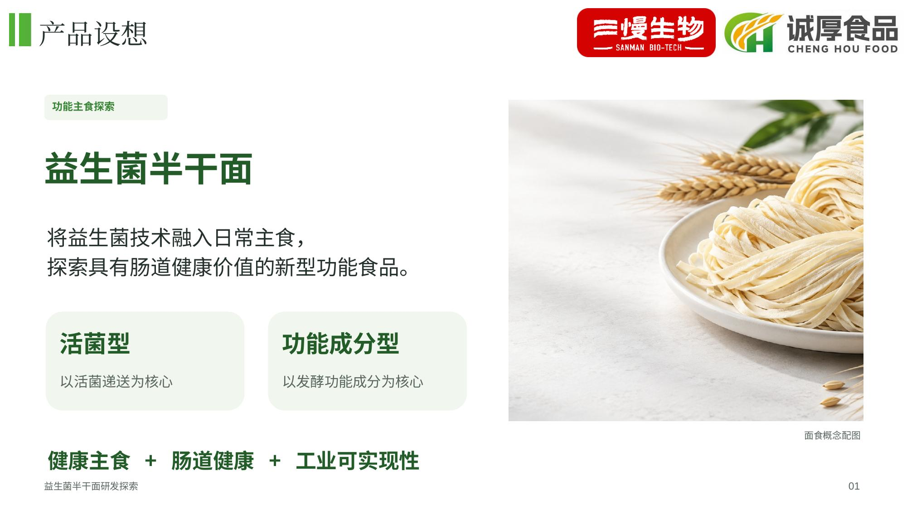
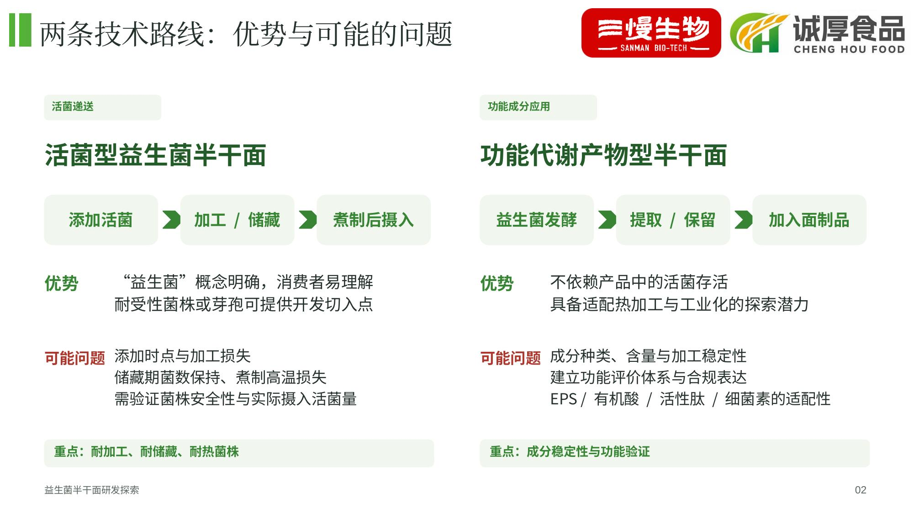
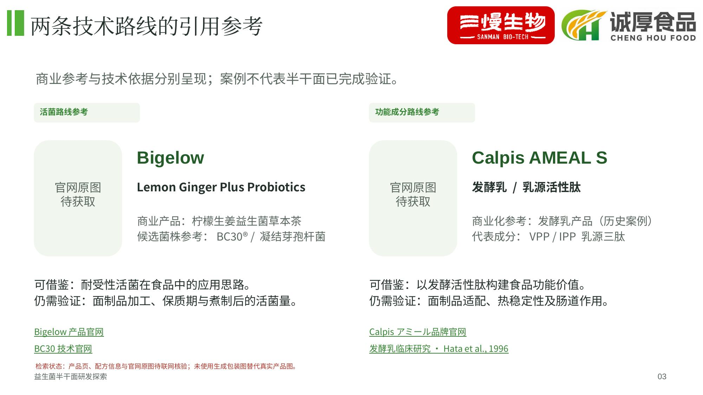

# 最新：三页模板版草稿

使用用户提供的背景模板，保留双品牌标识与绿色页眉，页面顺序为产品设想、技术路线及优劣势、两条路线的引用参考。

**当前状态：** 前两页已完成；第三页已排版，但候选产品、配方信息和参考文献仍待联网核验，官网真实产品图尚未获取。环境网络策略拦截官网与论文网站，因此暂不把本文件作为最终验证版。尚未用生成包装图冒充真实产品图。

- [下载三页 PPT 草稿](three-slide/presentation-draft.pptx)
- [查看三页 PDF 草稿](three-slide/presentation-draft.pdf)
- [查看参考检索状态](three-slide/references-status.md)

打开文件页面，点击 **Download raw file** 下载。

## 直接查看页面

## 之前的八页版本

# 益生菌半干面开发方向探索

8 页、16:9、可编辑 PPT。已移除开发背景，补充面食与食品发酵实验室概念配图，并整理技术路线、应用参考、研发策略与产品定位。

- [下载 PPT](probiotic-noodles.pptx)
- [查看 PDF](probiotic-noodles-preview.pdf)

打开文件页后点击 Download raw file（下载原始文件）即可保存。

配图为 AI 生成的概念配图，不代表实际产品样品或实验现场。
