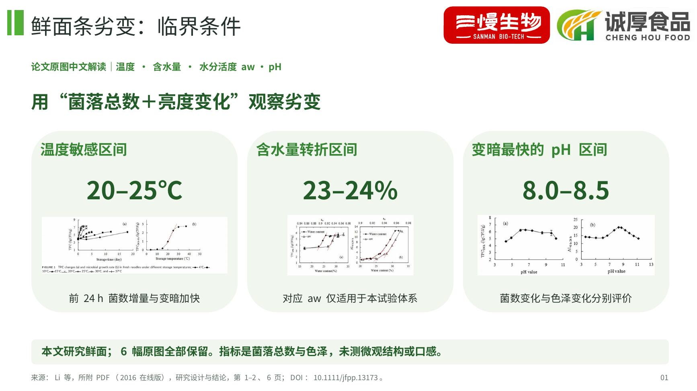
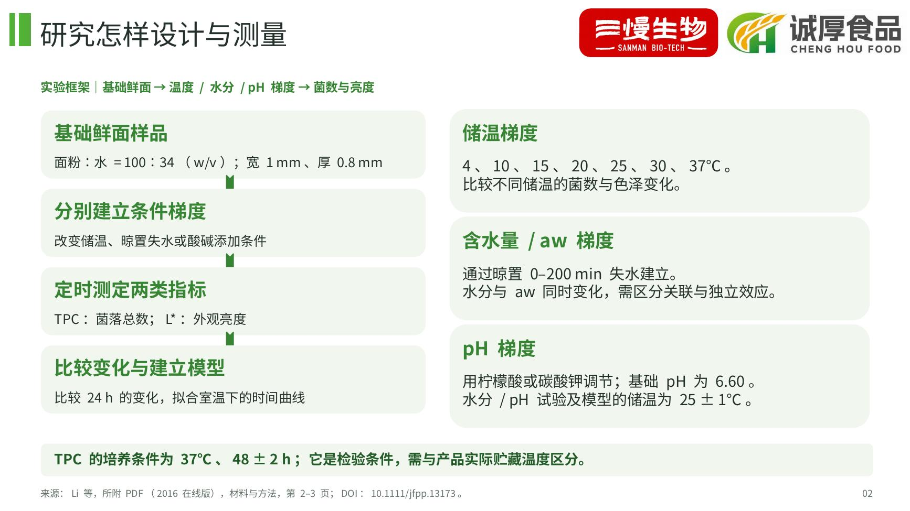
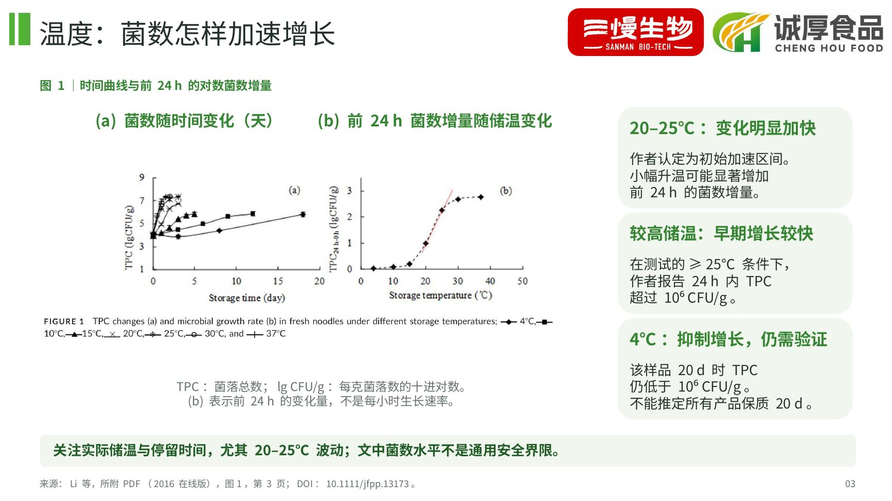
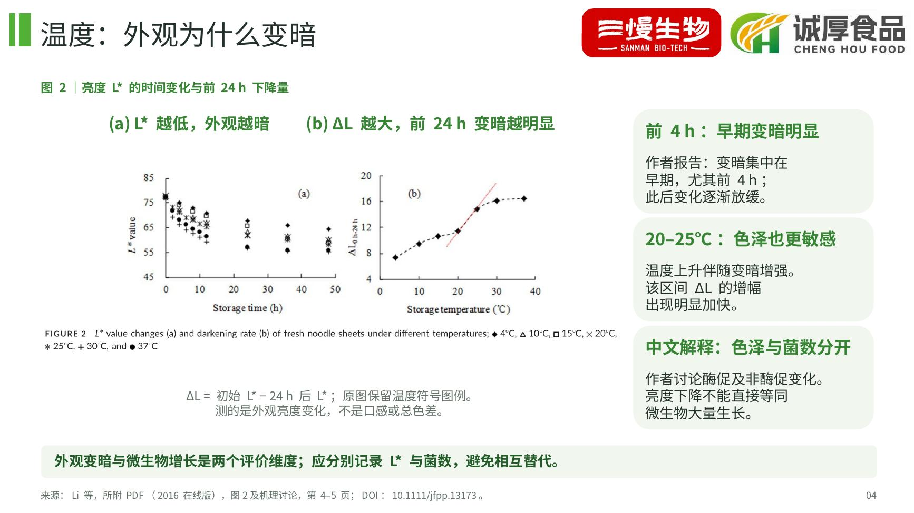
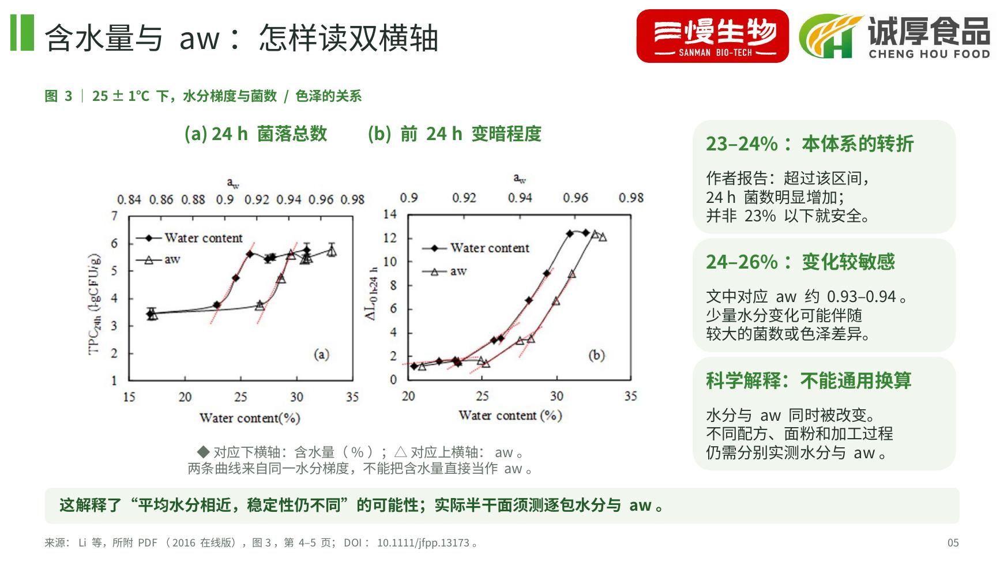
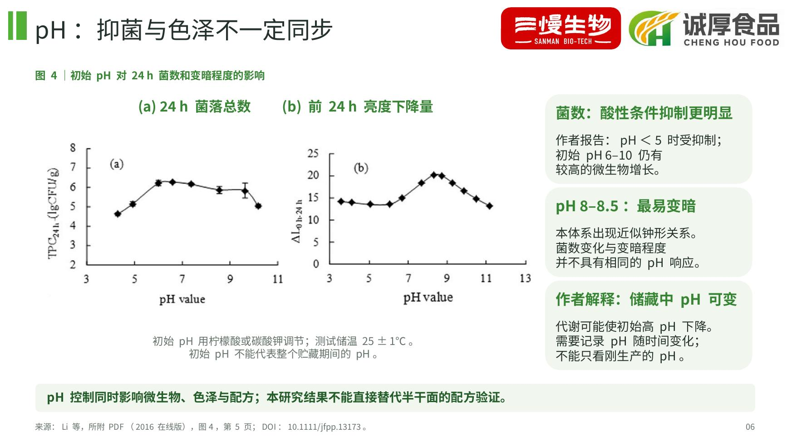
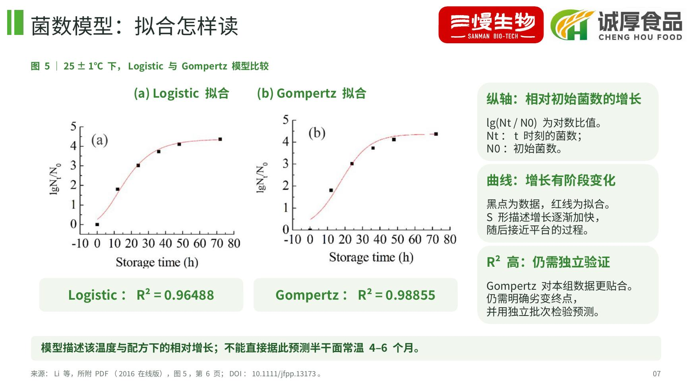
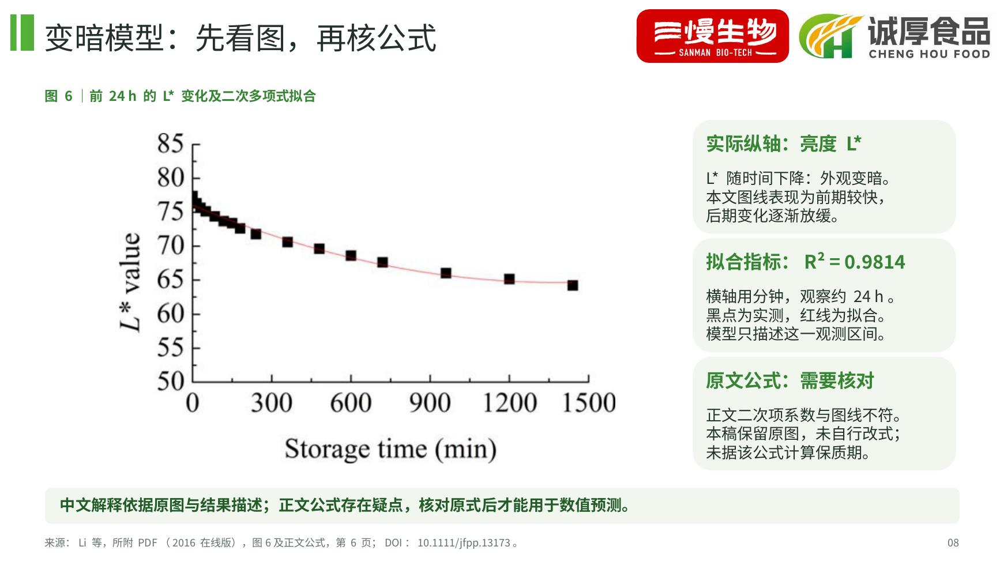
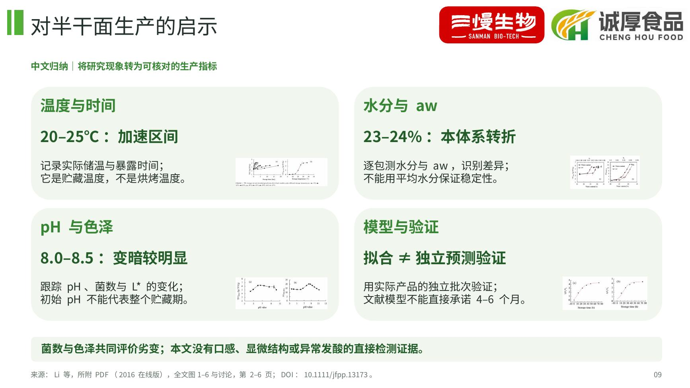

# 鲜面条劣变临界条件｜论文原图中文解读

共9页，沿用此前绿色版式与双品牌标识。涵盖用户提供论文的全部6幅图，并加入中文介绍、实验设计、坐标说明、结果解读与对半干面生产的启示。

- [下载 PPT](presentation.pptx)
- [查看 / 下载 PDF](presentation.pdf)
- [下载原图包（6张PNG＋来源索引）](article-figures.zip)
- [图片来源](figure-sources.md)
- [内容与科学核对说明](content-review.md)

打开文件页面，点击 **Download raw file**（下载图标）保存。

研究对象是基础配方鲜面，指标为菌落总数TPC与亮度L*；没有显微结构或口感实测。图中的温度、水分与pH区间已注明试验适用条件。图6正文公式与图线存在不一致，已标注需核对，未据该公式预测保质期。

原图保留坐标、图例、误差线及拟合曲线；新增中文文字、流程及总结框可编辑。

来源：Li M., Ma M., Zhu K.-X., Guo X.-N., Zhou H.-M. Critical conditions accelerating the deterioration of fresh noodles: A study on temperature, pH, water content, and water activity. Journal of Food Processing and Preservation，所附PDF为2016年在线版。

论文网址：https://doi.org/10.1111/jfpp.13173

## 逐页预览

### 01 鲜面条劣变：临界条件

### 02 研究怎样设计与测量

### 03 温度：菌数怎样加速增长

### 04 温度：外观为什么变暗

### 05 含水量与 aw：怎样读双横轴

### 06 pH：抑菌与色泽不一定同步

### 07 菌数模型：拟合怎样读

### 08 变暗模型：先看图，再核公式

### 09 对半干面生产的启示

