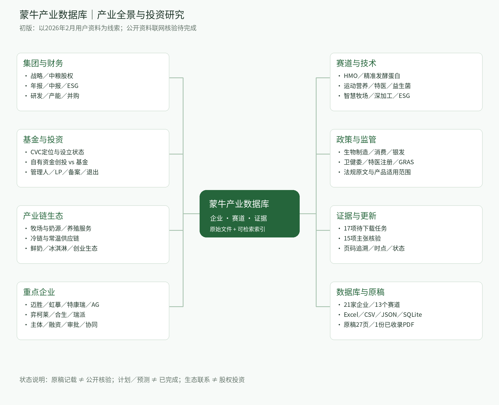

# 蒙牛产业数据库｜产业全景与投资研究（初版）

- [下载完整资料包 ZIP](mengniu-database.zip)
- [下载 Excel 数据库](mengniu-database.xlsx)
- [下载思维导图 PDF](mengniu-mindmap.pdf)
- [下载可编辑思维导图 OPML](mindmap.opml)

打开文件页面，点击 **Download raw file**（下载图标）保存。

完整资料包解压后打开“打开这里_数据库导航.html”，可搜索企业并查看分类资料。

包含21家企业、13个赛道、企业卡片、思维导图、Excel/CSV/JSON/SQLite、用户提供原稿及资料索引。

**资料状态：**仅收录用户提供的1份原始PDF；外部公开资料尚未下载和独立核验。17项下载任务及15项主张核验均保留待完成状态，不能作为已核验投资结论。

