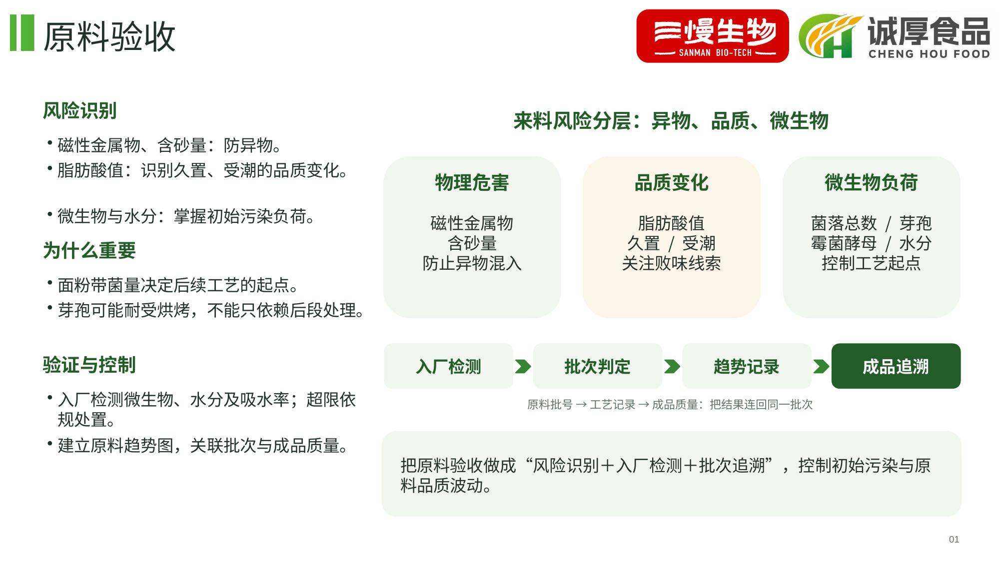
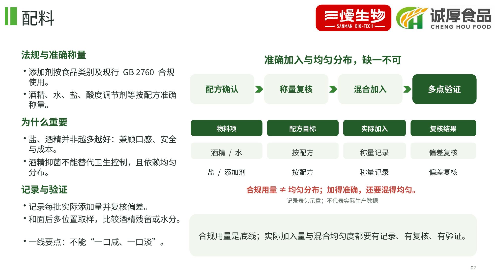
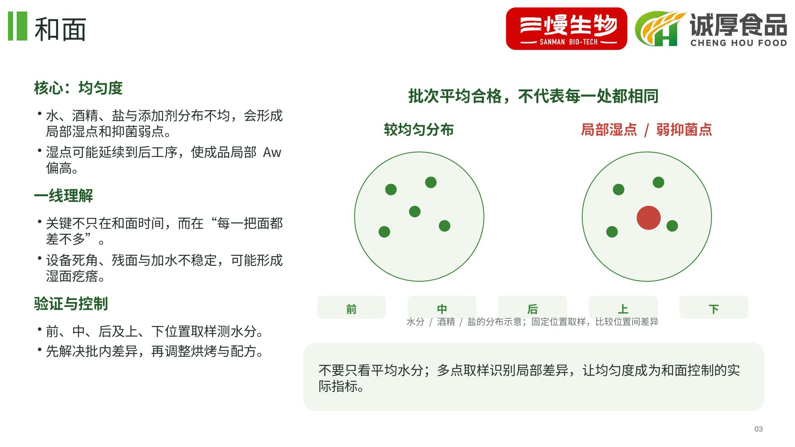
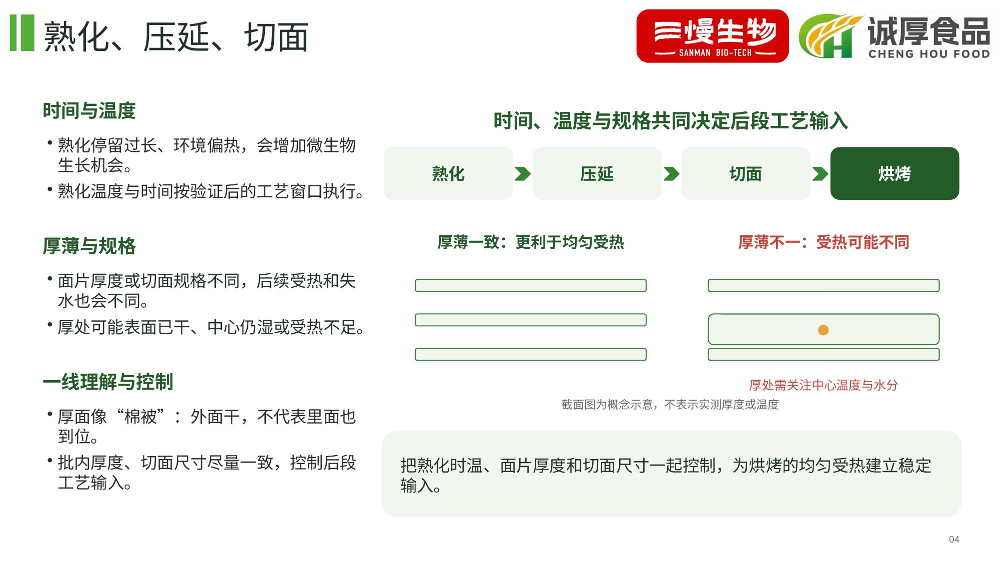
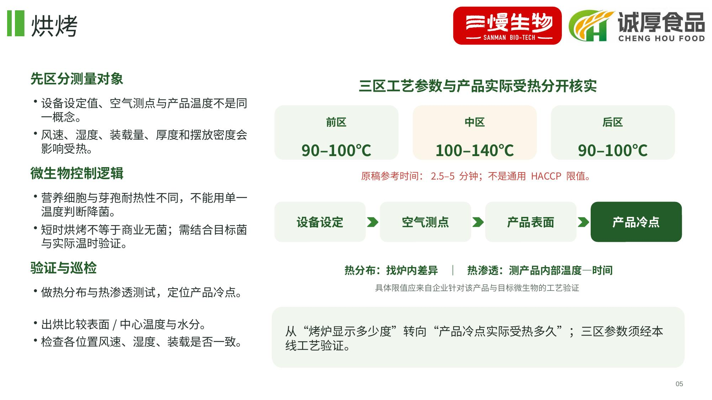
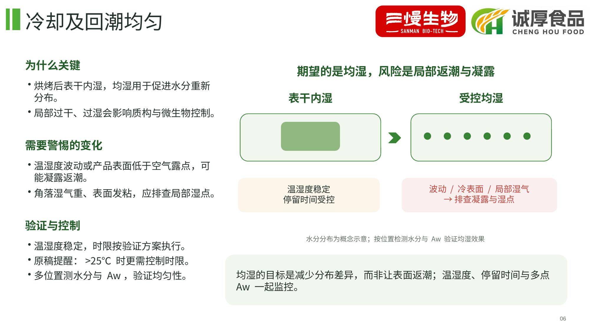
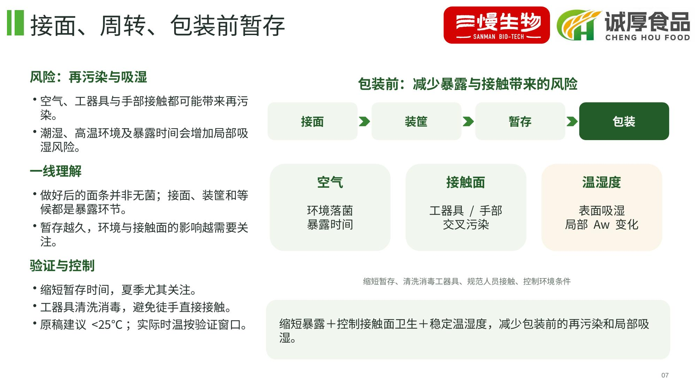
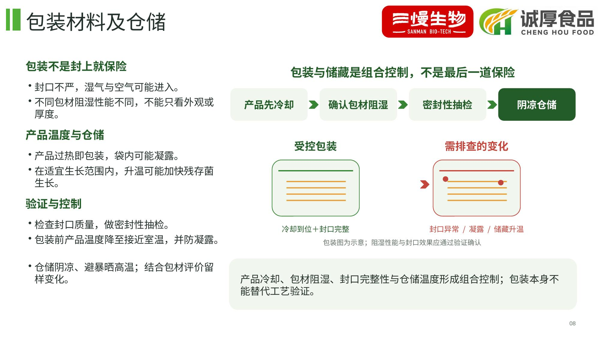
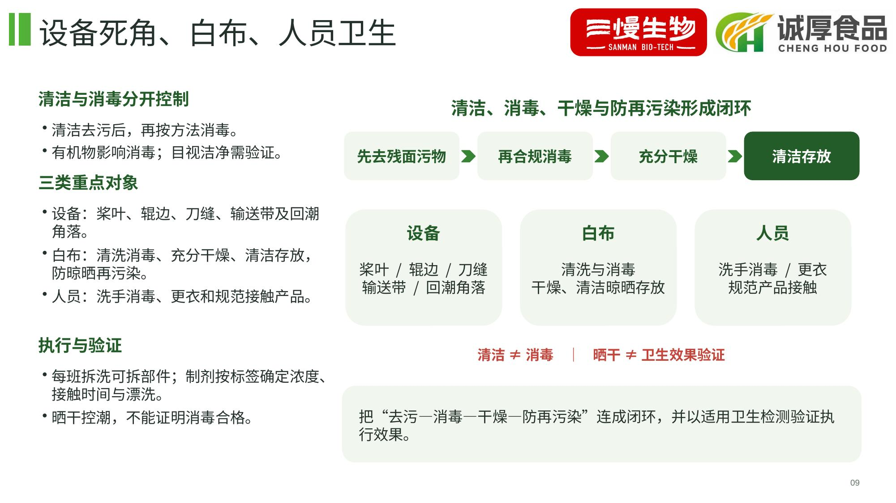

# 原料验收与和面控制要点｜统一风格版

以用户提供的《核心控制-水分活度-Aw.pptx》为视觉参考，逐页重排《原料验收与和面控制要点.pptx》，保留九页内容顺序，无额外封面。

统一保留双品牌标识、绿色页眉、白色背景及“左侧分层讲解＋右侧图解＋底部行动结论”结构。字体采用可稳定渲染的中文字体；正文、流程、分布图、对照表等均可编辑。图解为概念或记录示意，没有编造实测数据。

- [下载可编辑 PPT](presentation.pptx)
- [查看 PDF](presentation.pdf)
- [阅读页面文字](content-summary.md)

打开 PPT 文件页面，点击右上角 **Download raw file**（下载图标）保存。

原稿每一页的全文均保存在对应页的演讲者备注中，便于核对。温度、时长及消毒剂用法补充了来源、适用条件和工艺验证说明，未把原稿数字提升为通用 HACCP、杀菌或放行限值。采用九页原始内容的一一对应关系，已验证备注保留、PPTX 文件结构及逐页视觉效果。

## 逐页预览

### 1. 原料验收

### 2. 配料

### 3. 和面

### 4. 熟化、压延、切面

### 5. 烘烤

### 6. 冷却及回潮均匀

### 7. 接面、周转、包装前暂存

### 8. 包装材料及仓储

### 9. 设备死角、白布、人员卫生

