# 半干面：质构与微观结构｜论文原图整理

共13页，沿用绿色与双品牌背景样式；从用户提供的赵恬田硕士论文中截取6幅图、7张表，保留图号、组别、坐标、误差线、显著性字母和显微比例尺。

- [下载 PPT](presentation.pptx)
- [查看 / 下载 PDF](presentation.pdf)
- [下载原图包（20张PNG＋来源索引）](article-figures.zip)
- [阅读图片来源](figure-sources.md)
- [阅读内容核对说明](content-review.md)

打开文件页面，点击 **Download raw file**（下载图标）保存。若浏览器未展示文件预览，可直接使用下载图标。

图表来自论文截图；新增说明文字、标题和总结框可编辑。原图包包含13张完整图表截图，以及图3-15的7组原始/拟合图配对截图。

主要内容：磷酸盐质构、SEM横截面、CLSM面筋网络、网络定量、MRI水分分布、pH与初始质构、pH与贮藏质构、包材与硬度/咀嚼性/弹性。正文与表格有差异的地方已标注，机理解释按作者观点呈现。

来源：赵恬田，《半干面的货架期延长与品质保持研究》[D]，江南大学，2022年6月。未新增实验数据。

## 逐页预览

### 01 半干面：质构与微观结构

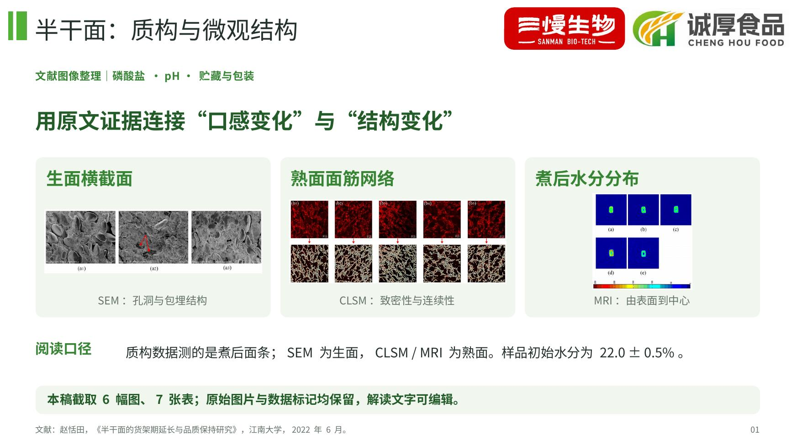

### 02 磷酸盐：硬度与拉伸力

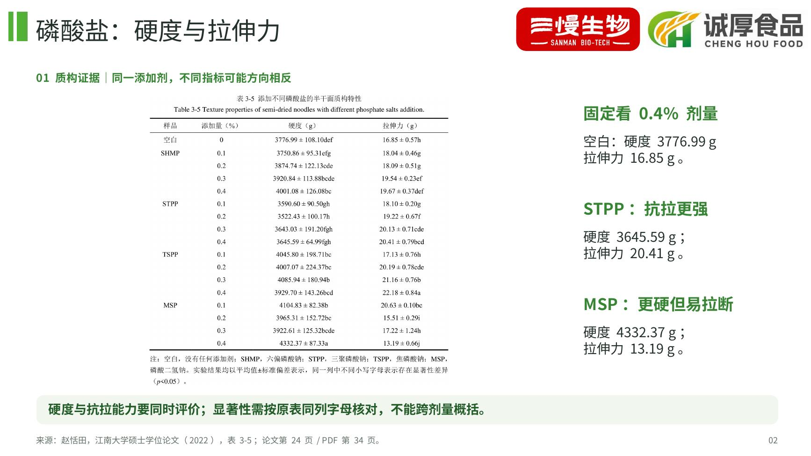

### 03 生面 SEM：孔隙与结构

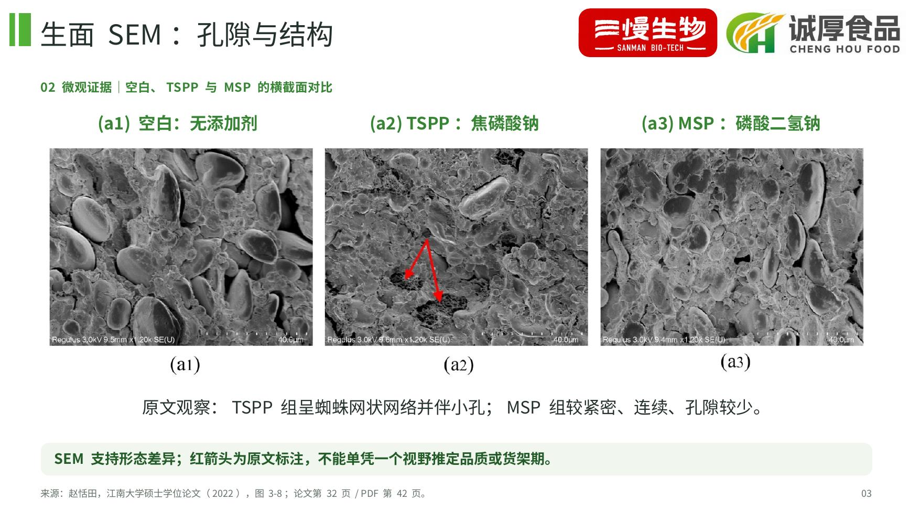

### 04 熟面 CLSM：面筋网络

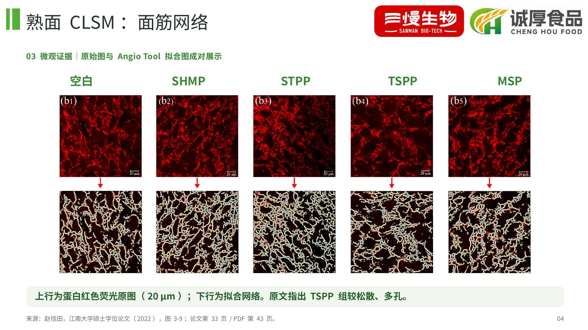

### 05 磷酸盐：网络定量分析

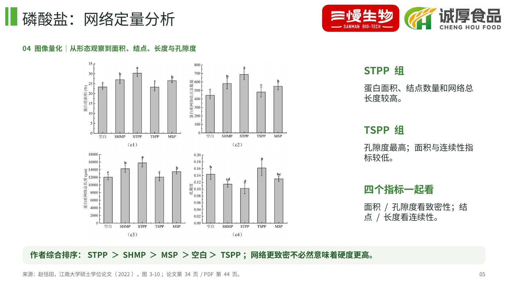

### 06 MRI：熟面水分分布

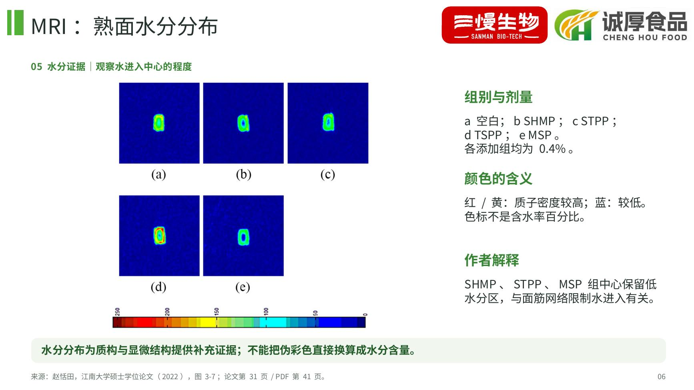

### 07 pH：初始质构与蒸煮

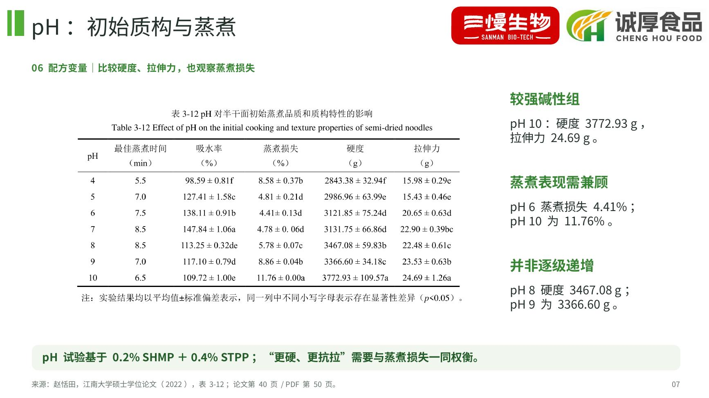

### 08 pH：熟面网络横向比较

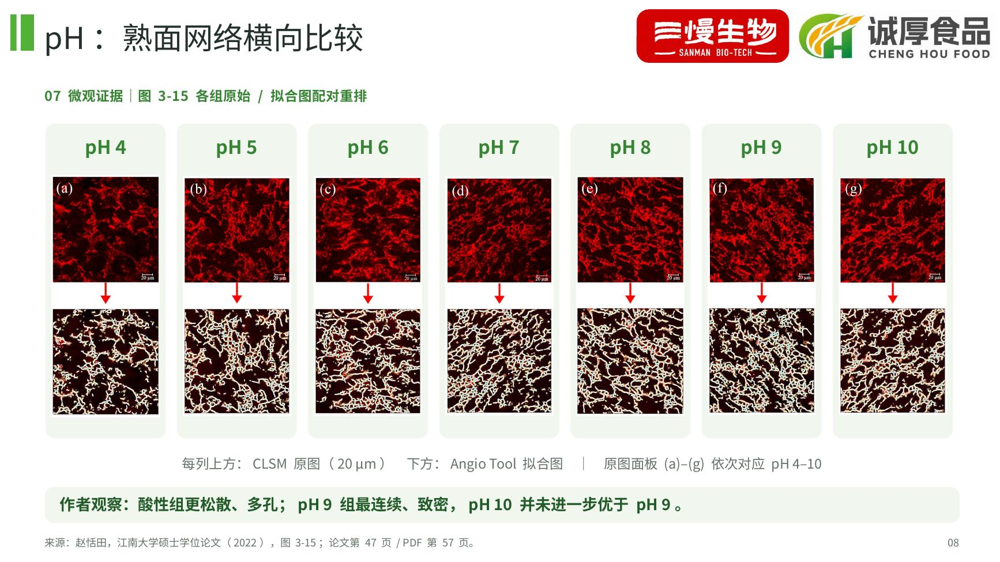

### 09 pH：网络变化的量化证据

### 10 贮藏：硬度与抗拉的分化

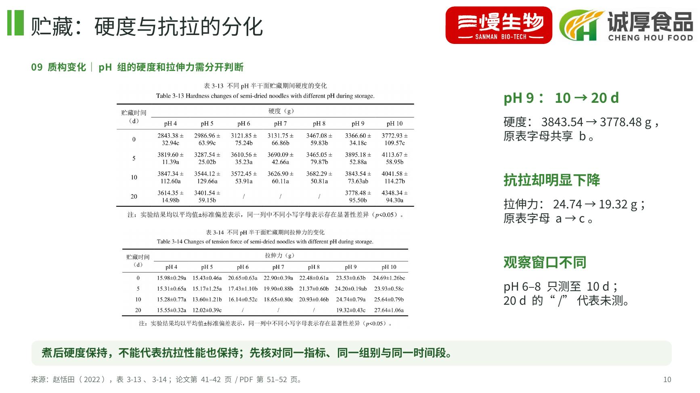

### 11 包装：贮藏硬度的变化

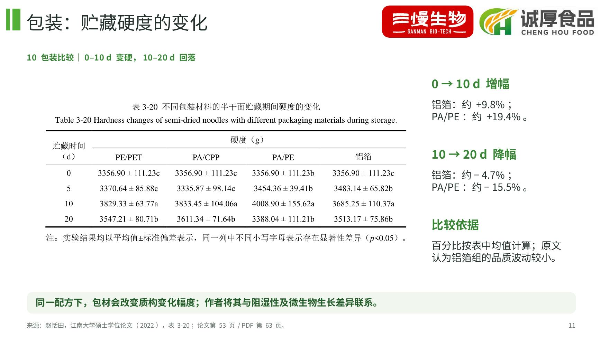

### 12 包装：咀嚼性与弹性

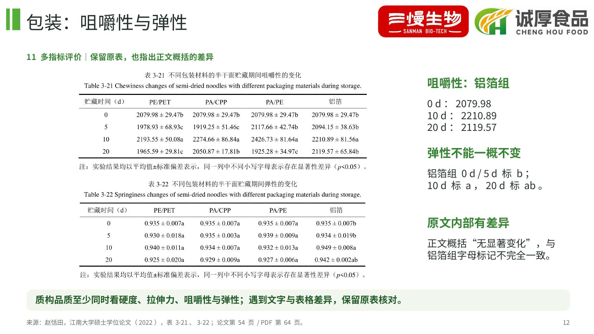

### 13 从结构证据到品质判断

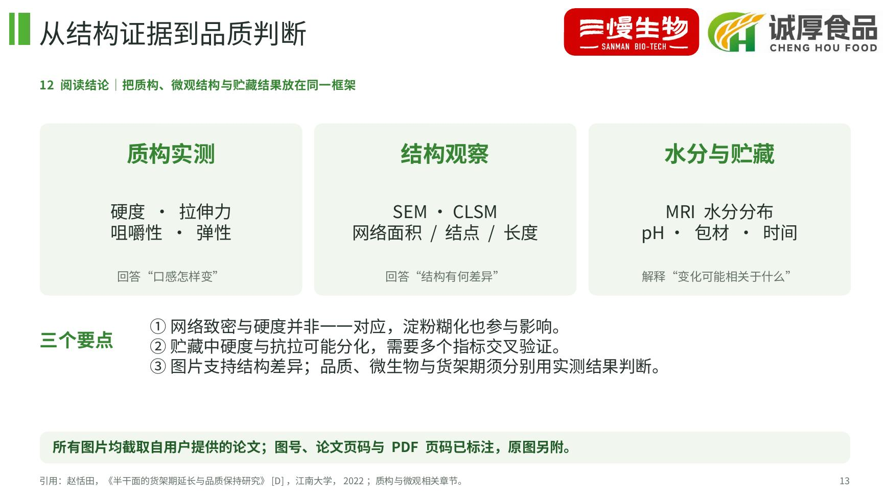
