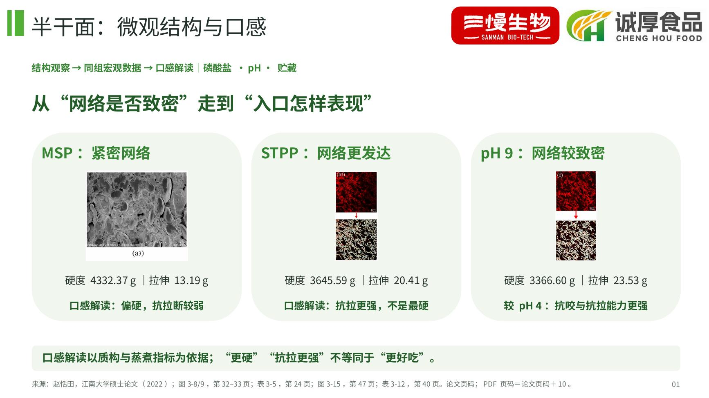
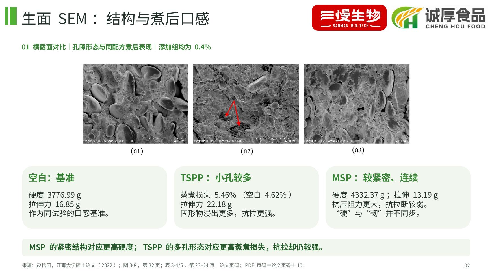
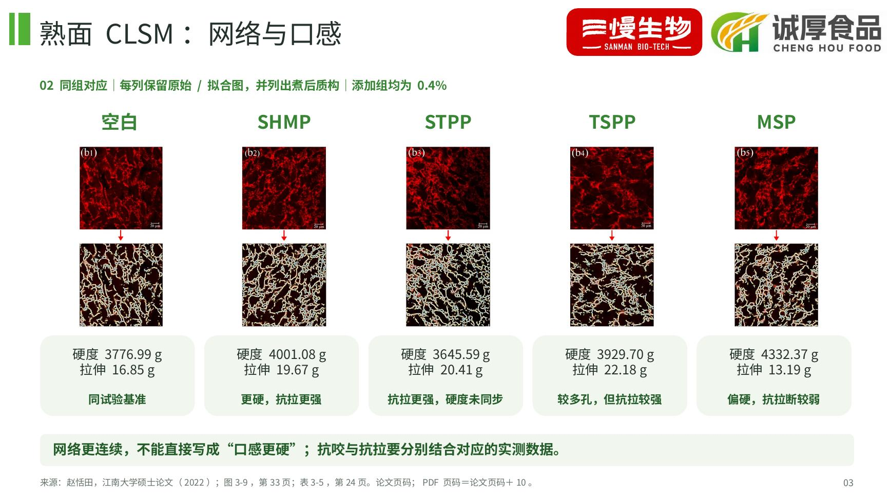
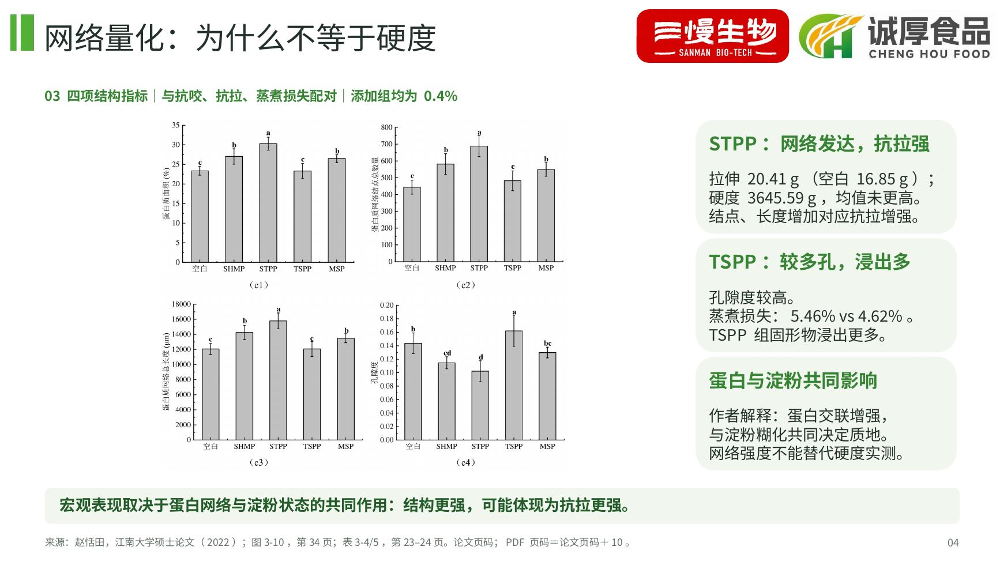
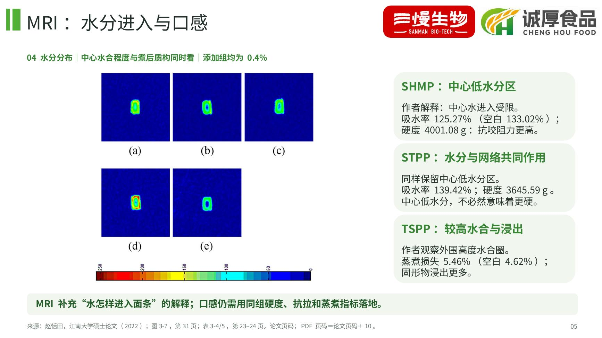
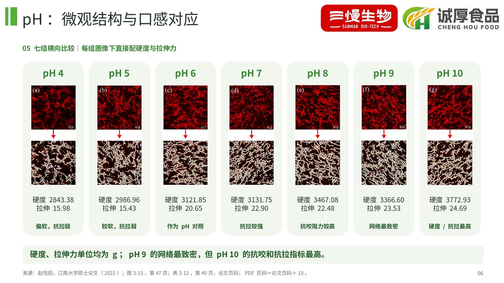
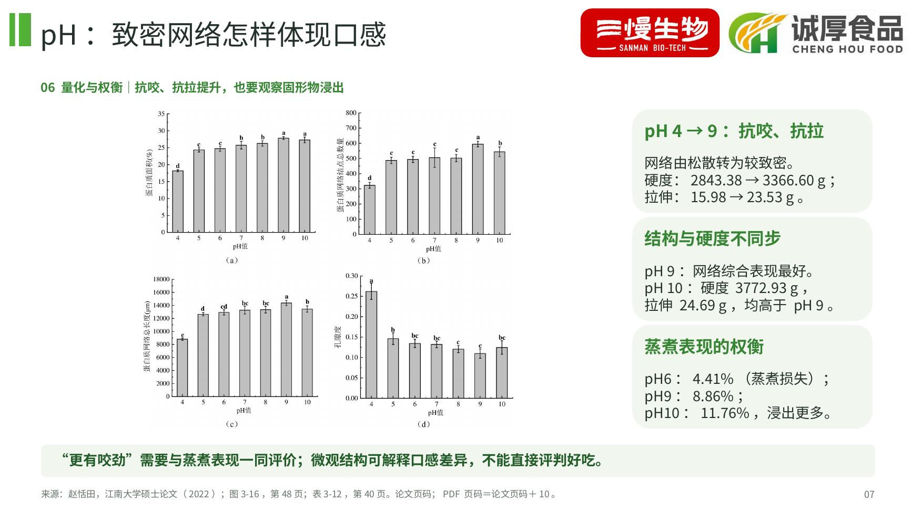
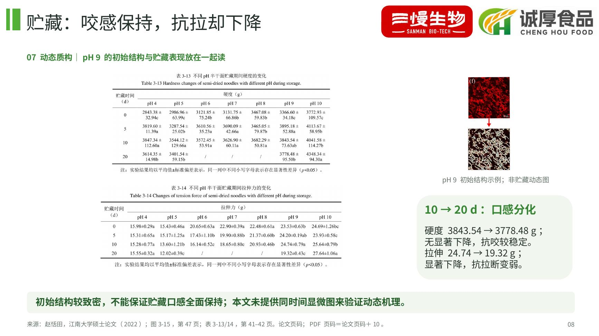
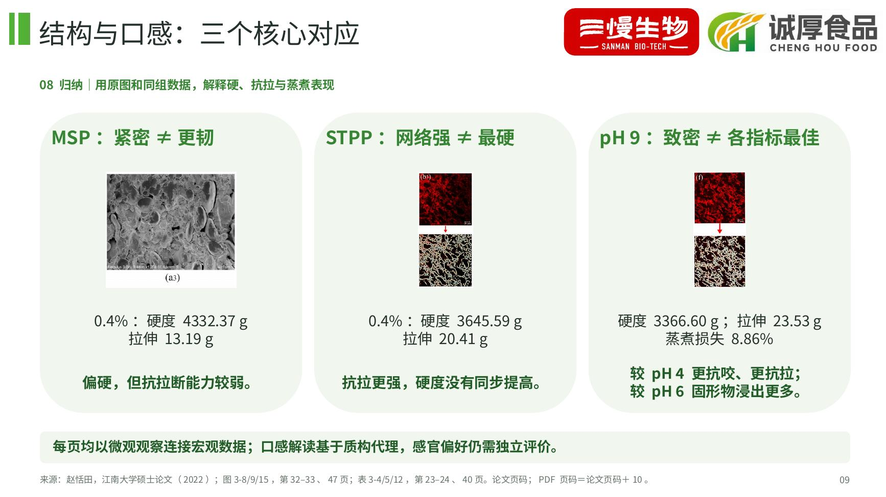

# 半干面：微观结构与宏观口感对应版

新版共9页，沿用绿色与双品牌背景。每页按照“结构图/网络量化 → 同组宏观数据 → 口感解读”呈现，覆盖磷酸盐、pH与贮藏。包装比较已删除。

- [下载新版 PPT](presentation.pptx)
- [查看 / 下载新版 PDF](presentation.pdf)
- [下载本版原图包（24张PNG＋来源索引）](article-figures.zip)
- [图片来源](figure-sources.md)
- [内容与数据核对说明](content-review.md)

打开文件页面，点击 **Download raw file**（下载图标）保存。

主要对应：MSP的紧密结构对应更高硬度但更低拉伸力；STPP网络较发达对应更强抗拉，硬度没有同步提高；TSPP较多孔对应较高蒸煮损失；pH各组同时展示显微图、硬度与拉伸力；贮藏页比较硬度和抗拉的不同变化。

口感解读基于质构及蒸煮指标，不替代感官喜好评分。磷酸盐图像与数值统一使用0.4%剂量；pH是另一配方试验。贮藏页图像明确标注为初始结构，未冒充动态显微证据。

来源：赵恬田，《半干面的货架期延长与品质保持研究》[D]，江南大学，2022年6月。

## 逐页预览

### 01 半干面：微观结构与口感

### 02 生面 SEM：结构与煮后口感

### 03 熟面 CLSM：网络与口感

### 04 网络量化：为什么不等于硬度

### 05 MRI：水分进入与口感

### 06 pH：微观结构与口感对应

### 07 pH：致密网络怎样体现口感

### 08 贮藏：咬感保持，抗拉却下降

### 09 结构与口感：三个核心对应

